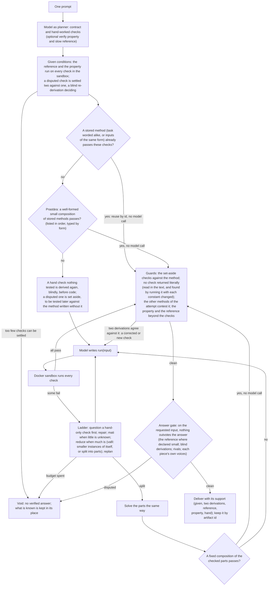

# Kuttaka

**One prompt in, a checked answer out, with any model.** Kuttaka wraps a model (local with Ollama, or any OpenAI-compatible endpoint such as Meta's Muse Glimmer) in a loop: the model states a contract and checks, writes `run(input)`, and Kuttaka runs it in a Docker sandbox. Failures go back to the model for repair. When the model only half-solves a task, Kuttaka splits it around the part that works, solves the pieces and recomposes them, as Āryabhaṭa's *kuṭṭaka* reduces a problem to smaller ones (vallī: keep the chain; mati: one small guess, checked at once). Checked methods, breakdowns and lessons stay on your machine, and later tasks reuse them by id. The model's weights never change; every claim is "the model with Kuttaka vs the same model without it".

Install (Python 3.11+ and Docker; methods only ever run in the pinned sandbox image):

```
git clone https://github.com/Arnav123-s/kuttaka && cd kuttaka && pip install -e .
docker pull python@sha256:aa943ce411423c7582288f18707ff66eddcbaeb510502d747a72aeb34f30d159
```

Then:

```
python3 -m kuttaka_runtime.solve "Return the n-th number that is both square and triangular" --model llama3.2
python3 -m kuttaka_runtime.solve "..." --protocol openai --base-url https://integrate.api.nvidia.com/v1 \
    --key-env NVIDIA_API_KEY --model meta/muse-glimmer-30b --rounds 3
kuttaka-serve mcp --model llama3.2        # the same solver as a tool for any MCP agent; `kuttaka-serve http` for an HTTP API
kuttaka library                           # every stored method: rule, form, support, rationale, lineage, open places
```

## How it works



The model is used for understanding the task, writing code, proposing checks and re-deriving values blindly; everything else (running, comparing, settling disputes two against one, searching hole fillings, composing checked parts, guarding against memorized checks, counting the voices at the answer gate) is deterministic. A check is trusted by where it comes from: the user's examples are given conditions and never change; a value the reference computes or the property accepts is stronger than one the model worked out by hand. Every result says which, and a result with nothing verified is reported as void, never as an answer. Progress is the number of checks passed, with a high-water mark; a method shown wrong later is never reused, and what two derivations confirmed for a task stays settled across replans and rounds. Every part, with its job, place and test, and every limit that cannot be closed (correctness on every input is undecidable): [docs/ARCHITECTURE.md](docs/ARCHITECTURE.md).
 **Evidence, wins and losses: [HACKATHON.md](HACKATHON.md).** Design study: [research/kuttaka_method/STUDY.md](research/kuttaka_method/STUDY.md).

Engineering diagnosis: [causes, repairs, regression tests, and remaining design work](docs/DIAGNOSIS_AND_REPAIR_2026-11-01.md).

Continuing the work: [current owners, named branches, takeover boundary, commits and resume instructions](docs/handoff/BUILDER_STATE.md).

## Layout

| Path | What |
|---|---|
| `kuttaka_runtime/` | The system: `solve.py` (the loop), `serve.py` (HTTP and MCP), the sandbox, method memory, journals and the campaign runner |
| `tests/` | Unit and integration tests |
| `experiments/` | Task suites (`solve_suite/`), the Erdős #979 task (`erdos979/`), the C1–C3 study material, and the agent's research experiments |
| `results/` | Recorded runs and scores |
| `research/kuttaka_method/` | The study of Āryabhaṭīya 2.32–33 that the design follows |
| `docs/` | Study protocols, the ledger (`docs/LEDGER.md`) and hand-off notes |
| `demo/video/` | The review film, built from recorded data |

## Prior work

The project's code was written from 2026-10-27; before that there were ideas and research only. [`docs/EVENT_PROVENANCE.md`](docs/EVENT_PROVENANCE.md) lists each part with its first commit, generated from the git history.

The owner's earlier research, cited here as prior work, is [KAVI](https://github.com/Arnav123-s/Kavi) (public; phase-circuit learning; last updated 2026-09-08).

## Licence

Apache License 2.0: see [LICENSE](LICENSE).
